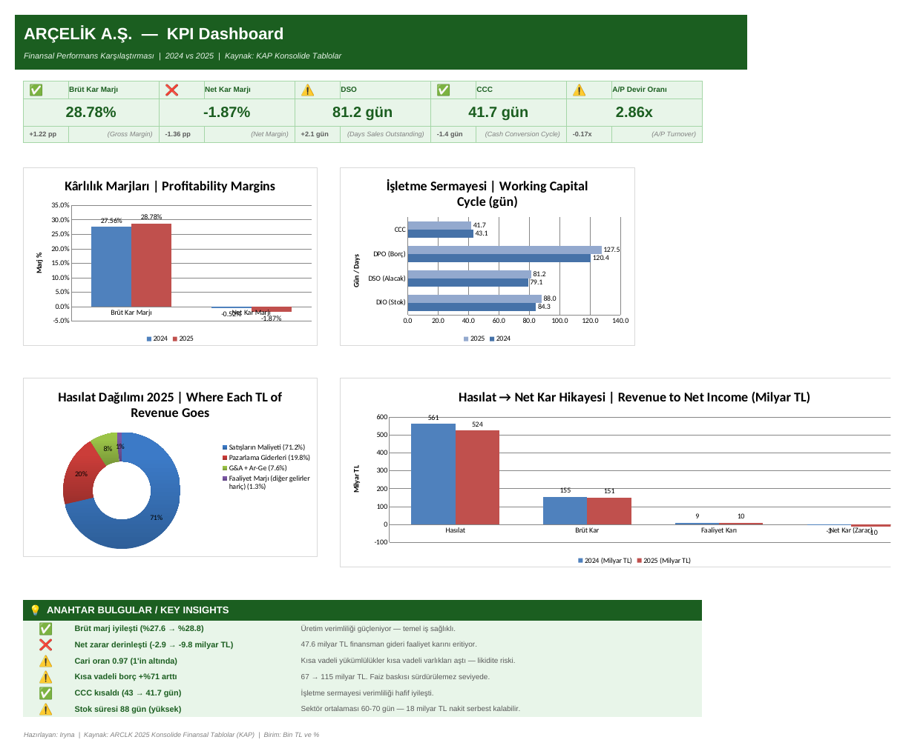

# Arçelik (BIST: ARCLK) — Financial KPI Dashboard, 2024 vs 2025

**Question:** Arçelik's gross margin improved in 2025. So why did its net loss more than triple?

**Answer in one line:** The core business got slightly more profitable, but financing costs of TRY 47.6bn consumed all of the operating profit. Liquidity is now tight, with a current ratio of 0.97.

## Data

- **Source:** Arçelik A.Ş. consolidated year-end financial statements for 2024 and 2025, published on KAP (Public Disclosure Platform, Turkey)
- **Scope:** 9 income statement lines and 12 balance sheet lines, for 2 years
- **Units:** thousand TRY (dashboard figures in billion TRY)

## What I built

| Sheet | Contents |
|---|---|
| `DASHBOARD` | KPI cards, 4 charts, and key insights |
| `1. Ham Veri (Raw Data)` | Raw financial statement data, colour-coded (inputs / cross-sheet links / formulas) |
| `2. KPI Hesaplamalari` | 5 KPIs + working-capital components, calculated with formulas linked to the raw data sheet |
| `3. Analiz ve Gerekce` | Why each KPI was chosen and what it shows for Arçelik |
| `4. Sonuc ve Oneriler` | Executive summary and 5 recommendations |
| `5. PQ Veri Kaynagi` | Flat table prepared for Power Query (unpivot → long format, 42 rows) |

The workbook is in Turkish. It was presented as a Turkish-language deliverable.

## KPIs

| KPI | Formula | 2024 | 2025 | Change |
|---|---|---|---|---|
| Gross profit margin | Gross profit ÷ Revenue | 27.6% | 28.8% | +1.2 pp ✅ |
| Net profit margin | Net income ÷ Revenue | −0.5% | −1.9% | −1.4 pp ❌ |
| DSO (days sales outstanding) | Trade receivables ÷ Revenue × 365 | 79.1 days | 81.2 days | +2.1 days ⚠️ |
| Cash conversion cycle | DIO + DSO − DPO | 43.0 days | 41.7 days | −1.3 days ✅ |
| A/P turnover | COGS ÷ Trade payables | 3.03× | 2.86× | slower ⚠️ |

The CCC components for 2025 are DIO of 88 days, DSO of 81 days and DPO of 128 days.

## Key findings

1. **Revenue fell 6.6%** (TRY 560.9bn → 523.9bn), yet gross margin improved, so the company made more per lira on a smaller sales base.
2. **Production efficiency improved, but the bottom line got worse.** Gross margin rose from 27.6% to 28.8%, and operating profit rose from TRY 9.3bn to TRY 10.5bn. Even so, the net loss widened from TRY 2.9bn to TRY 9.8bn.
3. **Financing costs are the main problem.** TRY 47.6bn of financing expenses outweighed operating profit by roughly 4.5×. The net loss (TRY 9.8bn) is smaller than operating profit minus financing expenses because finance income and other items, which are not in this dataset, partly offset them.
4. **Short-term debt rose 71%**, from TRY 67.3bn to TRY 115.0bn. As a result, the current ratio fell below 1, from 1.04 to 0.97.
5. **More cash, but more debt.** Cash rose 47% (TRY 66.5bn → 97.8bn), but net debt still rose 21% (TRY 114.2bn → 138.1bn) and equity fell 23% (TRY 98.3bn → 75.9bn). The extra cash was borrowed.
6. **Marketing expenses are 19.8% of revenue** (TRY 104bn), which makes them the largest operating cost after COGS.
7. **Inventory is held for 88 days.** Reducing that to 70 days would free roughly TRY 18bn of cash.

## Recommendations

1. Refinance part of the short-term debt into long-term debt to bring the current ratio back above 1.
2. Review marketing return on investment. A 2 pp reduction in marketing as a share of revenue would add about TRY 10bn to operating profit.
3. Reduce inventory days from 88 to 70 through demand forecasting and SKU simplification.
4. Tighten collections. Bringing DSO down from 81 to 70 days would free about TRY 16bn.
5. Review currency and interest-rate hedging, since most of the loss comes from financing.

## Tools

Excel (cross-sheet formulas, KPI modelling, charts) · Power Query data preparation

## Files

- `Arcelik_KPI_Dashboard.xlsx` — full workbook
- `dashboard_preview.png` — dashboard screenshot
